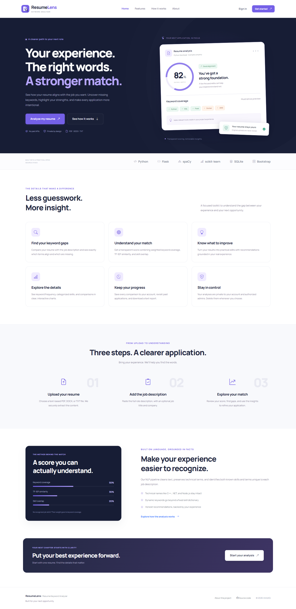
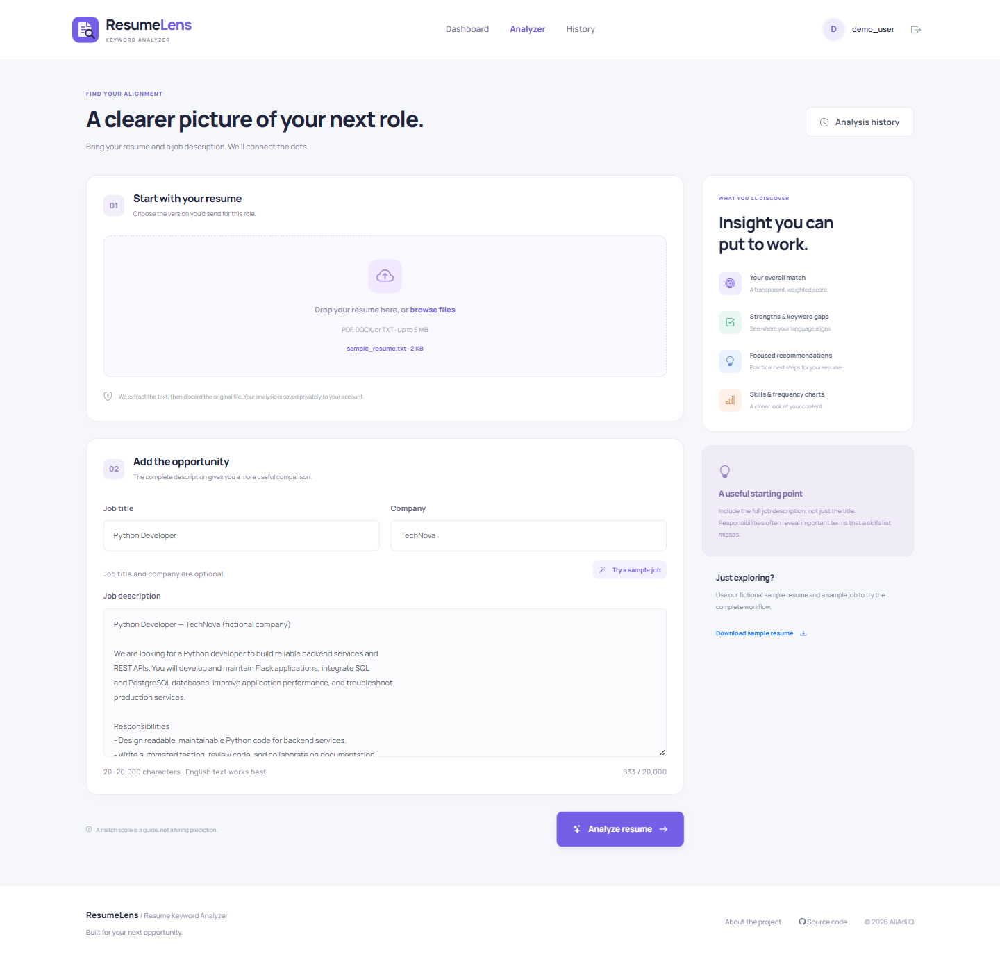
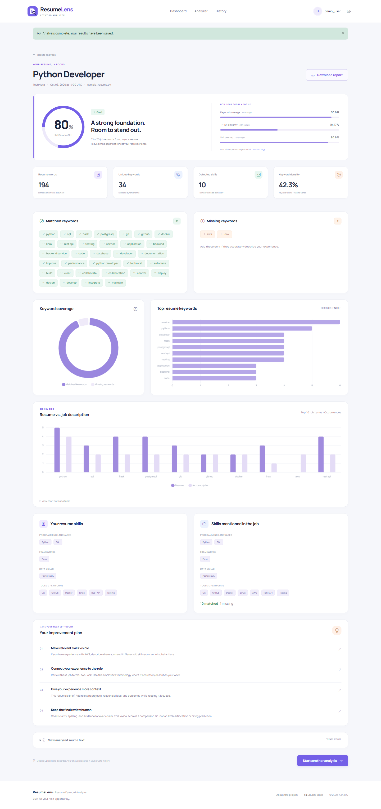
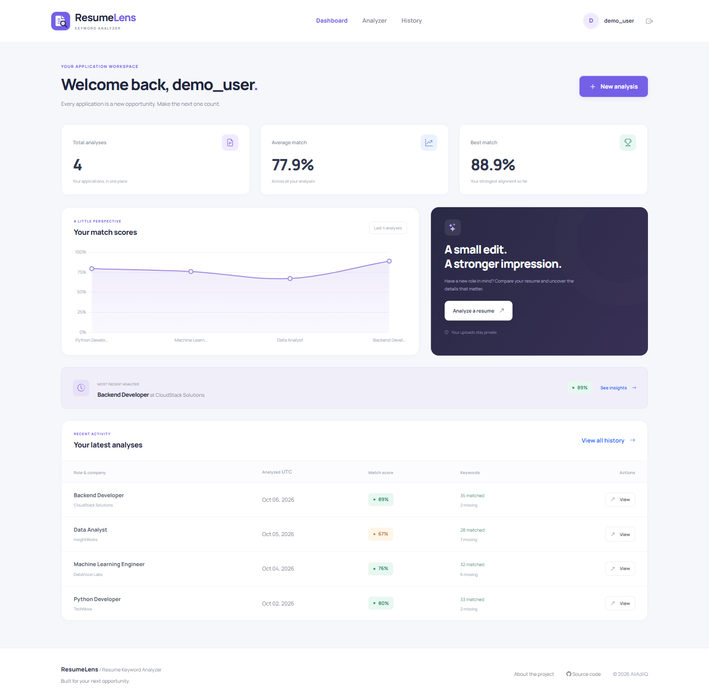
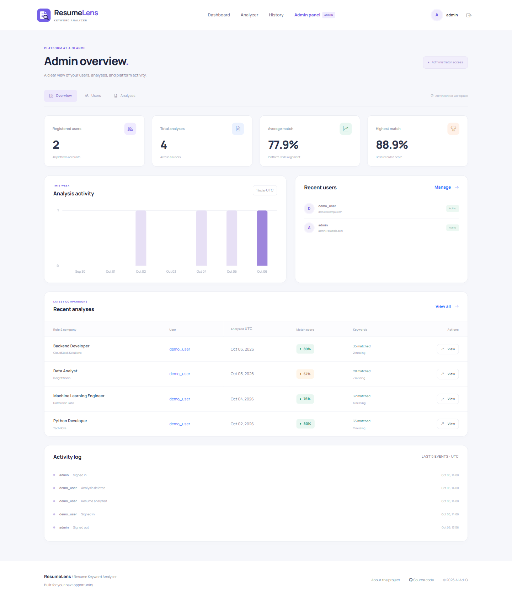

# Resume Keyword Analyzer

**Your experience. The right words. A stronger match.**

[](https://www.python.org/)
[](https://flask.palletsprojects.com/)
[](https://www.sqlite.org/)
[](https://scikit-learn.org/)
[](https://getbootstrap.com/)
[](https://github.com/AliAdilQ/Resume_Keyword_Analyzer/actions/workflows/tests.yml)
[](LICENSE)

## Project Overview

Resume Keyword Analyzer is a complete Flask application for comparing a resume with a job description. Its interface, **ResumeLens**, presents an explainable match score, keyword gaps, categorized skills, interactive charts, and practical recommendations. Registered users can save, revisit, download, and delete their analyses. Administrators have a separate workspace for platform metrics, accounts, and analysis management.

The project demonstrates Python, Flask, NLP, SQLite persistence, authentication, file extraction, data visualization, and a modular application architecture. It uses no paid APIs and makes no external calls during analysis. Original resume uploads are never saved to disk.

## Features

- **Resume extraction:** text-based PDF, DOCX paragraphs and tables, and UTF-8 TXT; validated extension, file size, empty content, and document structure.
- **Language processing:** Unicode normalization, NLTK tokenization, English stopword removal, and spaCy lookup lemmatization with protected technical terms.
- **Keyword discovery:** known technical skills plus dynamically ranked words and repeated phrases from each document.
- **Explainable matching:** weighted keyword coverage, TF-IDF cosine similarity, skill overlap, score breakdown, and four score states.
- **Useful results:** matched and missing keywords and skills, word count, keyword density, recommendations, and downloadable TXT reports.
- **Visualization:** doughnut coverage, keyword frequency bars, resume/job comparison bars, user score trends, and weekly admin activity.
- **Personal workspace:** registration, sign-in, dashboard, searchable paginated history, and permanent analysis deletion.
- **Admin workspace:** live metrics, searchable user accounts, user details, activation controls, activity logs, and analyses filtered by company, role, score, and date.
- **Polished UI:** reusable Jinja templates, original SVG logo, responsive layouts, keyboard support, loading indicators, flash messages, and confirmation dialogs.
- **Local assets:** Bootstrap, Bootstrap Icons, Chart.js, and Manrope fonts are vendored with their licenses. No CDN is required.

## Screenshots

These are genuine captures of the implemented application using fictional local demo data. The landing page's small preview card is explicitly illustrative; dashboard and result metrics come from SQLite and the real analyzer.

### Home Page



### Resume Analyzer



### Analysis Result



### User Dashboard



### Admin Dashboard



## Technology Stack

### Backend

Python 3.11+, Flask, Flask-SQLAlchemy / SQLAlchemy, Flask-Login, Flask-WTF / WTForms, Werkzeug, and python-dotenv. pypdf and python-docx handle document extraction. Waitress supports production-style serving.

### Frontend

HTML5, Jinja, CSS3, JavaScript, Bootstrap 5.3.8, Bootstrap Icons 1.13.1, Chart.js 4.5.1, and Manrope. All browser dependencies are bundled locally with their licenses.

### NLP

spaCy lookup lemmatization with spacy-lookups-data, NLTK RegexpTokenizer, and scikit-learn TF-IDF / cosine similarity.

### Database

SQLite3 through SQLAlchemy, with JSON analysis payloads and indexed owner and timestamp columns.

Verification uses pytest, optional Playwright browser checks, and GitHub Actions.

No spaCy pretrained model or NLTK corpus download is necessary. `spacy-lookups-data` is installed by `requirements.txt`. The application uses a lightweight English pipeline with lookup lemmas; it does not run a neural model.

## Project Structure

```text
Resume_Keyword_Analyzer/
├── app/
│   ├── __init__.py          # Factory, security headers, errors, initialization
│   ├── extensions.py       # SQLAlchemy, LoginManager, CSRF
│   ├── models.py           # User, ResumeAnalysis, ActivityLog
│   ├── forms.py            # Validated authentication and upload forms
│   ├── auth.py             # Registration, login, logout, throttling
│   ├── routes.py           # Public pages and private analysis workflows
│   ├── admin.py            # Admin authorization and management
│   ├── analyzer.py         # NLP, keyword discovery, weighted scoring
│   ├── services.py         # Persistence, dashboard aggregates, TXT reports
│   ├── utils.py            # Validated in-memory extraction
│   ├── templates/
│   │   ├── base.html       # Shared responsive layout
│   │   ├── macros.html     # Fields, tables, pagination, skills, scores
│   │   ├── index.html, about.html, auth_layout.html
│   │   ├── login.html, register.html, dashboard.html
│   │   ├── analyze.html, result.html, history.html
│   │   ├── admin/          # Overview, accounts, details, analyses
│   │   └── errors/         # 400, 403, 404, 500
│   └── static/
│       ├── css/style.css
│       ├── js/main.js
│       ├── images/logo.svg
│       ├── samples/        # Public fictional examples for the demo UI
│       └── vendor/         # Versioned assets and third-party licenses
├── instance/.gitkeep        # Ignored private SQLite database lives here
├── uploads/.gitkeep         # Reserved private path; uploads are not persisted
├── sample_data/             # Fictional resumes and job descriptions
├── screenshots/             # Five real application screenshots
├── scripts/                 # Asset maintenance and browser verification
├── tests/                   # Isolated pytest suite
├── .github/workflows/tests.yml
├── config.py
├── run.py
├── seed.py
├── requirements.txt
├── pytest.ini
├── package.json             # Optional screenshot tooling only
├── .env.example
├── .gitignore
├── README.md
├── CONTRIBUTING.md
└── LICENSE
```

## Installation

Use **Python 3.11 or newer**; Python 3.12 is recommended and was used for local verification. Python 3.8 is unsupported. Node.js is only needed if you want to regenerate screenshots.

### 1. Clone the repository

```bash
git clone https://github.com/AliAdilQ/Resume_Keyword_Analyzer.git
cd Resume_Keyword_Analyzer
```

### 2. Create and activate a virtual environment

Windows PowerShell:

```powershell
python -m venv venv
.\venv\Scripts\Activate.ps1
```

Windows Command Prompt:

```bat
python -m venv venv
venv\Scripts\activate
```

Linux/macOS:

```bash
python3 -m venv venv
source venv/bin/activate
```

If PowerShell prevents activation, you can call `venv\Scripts\python.exe` directly for each Python command and use `venv\Scripts\python.exe -m pip` to install dependencies.

### 3. Install dependencies

```bash
pip install -r requirements.txt
```

No additional NLP download command is required.

### 4. Configure the environment

Windows PowerShell:

```powershell
Copy-Item .env.example .env
python -c "import secrets; print(secrets.token_hex(32))"
```

Linux/macOS:

```bash
cp .env.example .env
python -c "import secrets; print(secrets.token_hex(32))"
```

Put the generated value in `.env` as `SECRET_KEY`. Keep `.env` private. Configuration is optional for a quick local demo: if no secret is supplied, development generates a random key per process. In that mode sessions expire when the process restarts.

### 5. Initialize demo data

```bash
python seed.py
```

This creates the database, two accounts, and four real computed sample analyses. Running it again preserves existing passwords and avoids duplicate seed records. Demo seeding is explicit; starting the app never creates or resets demo credentials.

### 6. Start the application

```bash
python run.py
```

Open **[http://127.0.0.1:5000](http://127.0.0.1:5000)**.

## Demo Accounts

### Demo Admin Credentials

Username: `admin`  
Email: `admin@example.com`  
Password: `Admin@123`

### Demo User

Username: `demo_user`  
Email: `demo@example.com`  
Password: `Demo@123`

> These credentials are provided for local demonstration only. Change the admin password before deploying the application publicly. Both demo accounts are intended only for local demonstration; change their credentials before public deployment.

The administrator signs in through the same `/login` page and is directed to `/admin/dashboard`. The regular demo user has four seeded analyses: Python Developer at TechNova, Machine Learning Engineer at DataVision Labs, Data Analyst at InsightWorks, and Backend Developer at CloudStack Solutions. All identities and organizations in the sample files are fictional.

Try the analyzer with `sample_data/sample_resume.txt` and `sample_data/python_developer_job.txt`. The analyzer also offers a sample resume download and a working “Try a sample job” button.

## How Resume Matching Works

1. **Text extraction:** the file is read into memory, validated, and decoded. DOCX tables are included. PDF extraction handles text-based documents, not scanned images.
2. **Preprocessing:** text is normalized to lowercase and Unicode NFKC; skill aliases are canonicalized. NLTK tokenizes, spaCy lookup lemmatization reduces ordinary words to lemmas, and English stopwords and generic recruitment words are removed. Protected skill phrases bypass destructive punctuation and stopword cleaning.
3. **Keyword extraction:** categorized dictionary skills are included, then single-document TF-IDF ranks up to 24 extra terms. Dynamic bigrams must occur twice, and incidental pairs of dictionary skills are excluded. Generic recruitment terms and sample-data disclaimers are removed. Keywords include terms outside the technical dictionary; these are not automatically labeled as skills.
4. **Keyword coverage:** job keywords are matched against resume unigrams and bigrams after normalization. Dictionary skills have base weight 2, other terms weight 1. Repeated job terms receive a multiplier of 1, 1.25, or 1.5. Coverage is the matched weight divided by total job-keyword weight.
5. **TF-IDF cosine similarity:** a second vectorizer fits both documents together using normalized unigrams and bigrams, sublinear term frequency, and inverse document frequency. The cosine between the vectors becomes a percentage. It measures lexical alignment, not embedding-based semantic understanding.
6. **Skill overlap:** recognized job skills found in the resume divided by all recognized job skills.
7. **Final weighted score:**

```text
Overall = 0.50 × weighted keyword coverage
        + 0.30 × TF-IDF cosine similarity
        + 0.20 × recognized skill overlap
```

When the job contains no recognized dictionary skills, the formula becomes `0.70 × keyword coverage + 0.30 × similarity`. This avoids awarding a free skills score. All components use a 0–100 scale; the overall score is rounded to one decimal place. The large score ring is rounded to an integer for readability.

| Overall score | State |
| --- | --- |
| 85–100 | Excellent |
| 70–<85 | Good |
| 50–<70 | Moderate |
| 0–<50 | Needs improvement |

Keyword density is the percentage of extracted resume words represented by selected keyword tokens. Multiword protected skills count as one keyword token, so this statistic is an estimate rather than an ATS metric. Charts display actual term counts; keyword coverage weights are reflected in the score breakdown.

Recommendations are deterministic rules: missing terms, missing recognized skills, brief resumes, skills section visibility, and measurable outcomes. They always encourage accurate descriptions of genuine experience.

**Limitations:** keyword dictionaries can miss unfamiliar technologies or match ambiguous names such as “Go.” Lookup lemmas do not use contextual part-of-speech predictions. Pair-fitted TF-IDF is sensitive to wording and document length; keyword matches are not a measure of professional competence. This is not an LLM, a deep-learning matcher, an ATS certification, or a hiring prediction.

## Supported Resume Formats

| Format | Support |
| --- | --- |
| PDF | Text-based PDF, unencrypted, up to 50 pages; scanned images require external OCR |
| DOCX | Paragraphs and table text; container expansion limited to 20 MB / 500 entries |
| TXT | UTF-8 or UTF-8 with BOM; binary content rejected |

Files must be nonempty and no larger than **5 MB**. Extracted text is limited to **60,000 characters**, and job descriptions to **20–20,000 characters**. Legacy `.doc` files are unsupported; export them as `.docx`, `.pdf`, or `.txt`.

## Database

The default database is `instance/resume_analyzer.db`. It is automatically initialized by the application factory or `seed.py` and ignored by Git.

- `User`: identity, hashed password, admin and activation flags, and creation time.
- `ResumeAnalysis`: owner, sanitized filename, role/company, private source text, scores, JSON keyword lists, full JSON report, optional unique seed key, and timestamp.
- `ActivityLog`: account and administrative actions with a user reference and timestamp. It never stores passwords or resume contents.

Timestamps and date filters use **UTC**, as labeled in the UI. Dashboard metrics are calculated from stored rows. Tests create a separate temporary SQLite database for every test.

The factory creates missing tables; it does not migrate existing schemas. Add a migration tool before evolving a deployed database. A custom `DATABASE_URL` can replace the default, but other database drivers and deployments require separate installation and validation.

## Admin Panel

| Route | Capability |
| --- | --- |
| `/admin/dashboard` | Total accounts and analyses, average/highest score, today's analyses, seven-day activity chart, recent users/analyses, activity log |
| `/admin/users` | Search usernames/emails, view counts and roles, activate/deactivate normal accounts |
| `/admin/users/<id>` | Account information, aggregate scores, paginated analysis history |
| `/admin/analyses` | Search title/company, filter by minimum/maximum score and UTC date range, view and delete records |

All admin routes enforce server-side authorization. Admins can review analysis text and reports. Self-deactivation and other administrator deactivation are protected. Deactivating an account blocks new sign-ins and revokes its access on its next request. Mutations use POST with CSRF protection and deletion confirmations.

## Security & File Privacy

- Werkzeug hashes passwords with its default scrypt method; plaintext passwords are never stored.
- Flask-Login protects account routes. Owners and authorized admins can view analysis records; unrelated users receive 404.
- Flask-WTF protects all POST forms against CSRF, including logout, deletion, and activation.
- Upload extension, size, content, and document structure are checked. `secure_filename` sanitizes the metadata filename. Uploads never enter the public static directory and are not written to disk.
- Extracted resume text and job descriptions **are stored** for history. The owner and authorized administrators can access them. Delete an analysis to remove its source text and results. Backups require their own retention policy.
- Jinja autoescapes user text, and chart data is serialized with `tojson`. SQLAlchemy performs parameterized queries; search wildcards are escaped.
- Session cookies are HttpOnly and SameSite=Lax; production mode requires an explicit secret and sets Secure cookies. Private responses use `Cache-Control: no-store`.
- Local assets support a Content Security Policy with scripts restricted to the same origin, plus clickjacking and MIME-sniffing protections.
- Login is throttled to 10 attempts per remote address per five minutes per process. Public multiworker deployments need a shared rate-limit backend and trusted proxy configuration.
- Live databases, environment secrets, uploaded files, caches, and virtual environments are excluded from Git.

### Production-style serving

Configure a strong `SECRET_KEY`, set `APP_ENV=production`, change both demo passwords or avoid seeding demo accounts, and serve behind HTTPS. Then use:

```bash
waitress-serve --call app:create_app
```

Production cookies require HTTPS. `python run.py` is for local development only. This portfolio includes the application safeguards above; a public service also needs database migrations, backups, monitoring, a shared rate limiter, and resource isolation for untrusted document parsing.

To change a seeded password locally, open the Flask shell:

```bash
flask --app run:app shell
```

```python
from getpass import getpass
from app.extensions import db
from app.models import User
user = db.session.scalar(db.select(User).where(User.username == "admin"))
user.set_password(getpass("New password: "))
db.session.commit()
```

Repeat for `demo_user`. Seeding again will preserve the updated hashes.

## Testing

With the virtual environment active:

```bash
pytest
```

Or:

```bash
python -m pytest -q
```

Tests cover registration and password hashing, valid/invalid sign-in, logout, CSRF, local redirects, throttling, activation and session revocation, user/admin authorization, private record ownership, upload/extraction for all three formats, validation failures, score boundaries and formula, technical aliases, dynamic keywords, HTML escaping, headers, search/filter behavior, report download, deletion, and idempotent seeding without password resets. No test modifies the demo database. GitHub Actions runs the same suite on Python 3.11 and 3.12.

Local verification on **October 6, 2026**, using Windows and Python 3.12.14: **79 pytest tests passed**, dependency checks passed, and the browser workflow verified 14 routes, a real upload/download/deletion, five charts, and mobile layouts. All five screenshots were captured from the running application. The CI workflow is included for runs after the repository is uploaded to GitHub.

### Browser verification & screenshot regeneration

With the seeded app running locally, install the optional Node.js tooling:

```bash
npm install
npx playwright install chromium
npm run screenshots
```

The script signs in with demo accounts, checks all result charts, verifies a real TXT upload and report download, deletes its temporary analysis, visits management pages, checks mobile overflow, and captures the five exact screenshot filenames. It reports browser errors and failed local assets. Default URL is `http://127.0.0.1:5000`; override `APP_URL` if needed. It assumes unchanged local demo credentials. Captures are generated from real pages, never composed as fake screenshots.

To refresh browser libraries, maintainers can run `python scripts/vendor_assets.py`. It fetches pinned npm tarballs, verifies their metadata integrity, and copies an explicit file allowlist. Python runtime dependency versions are pinned in `requirements.txt`.

## Future Improvements

- Contextual transformer embeddings for semantic similarity, with evaluated limitations.
- Resume section detection and optional OCR for scanned documents.
- Better handling of ambiguous skill names and custom industry dictionaries.
- Multiple languages and language-specific normalization.
- A versioned REST API with explicit authentication.
- PostgreSQL deployment with migrations and tested database support.
- Shared rate limiting, background document processing, and account password recovery.
- Docker packaging and a documented HTTPS deployment pipeline.
- Carefully evaluated ATS-related formatting checks without claiming universal ATS compatibility.

## Author

### AliAdilQ

GitHub: [AliAdilQ](https://github.com/AliAdilQ)

## Repository

[AliAdilQ / Resume_Keyword_Analyzer](https://github.com/AliAdilQ/Resume_Keyword_Analyzer)

Suggested GitHub topics:

```text
python flask machine-learning nlp resume-analyzer keyword-extraction sqlite
bootstrap scikit-learn data-science web-development portfolio-project
```

## Contributing

See [CONTRIBUTING.md](CONTRIBUTING.md) for setup, validation, and pull request guidance.

## License

[MIT License](LICENSE). Copyright © 2026 AliAdilQ. Vendored dependencies retain their own MIT or SIL Open Font License notices in `app/static/vendor/`.
